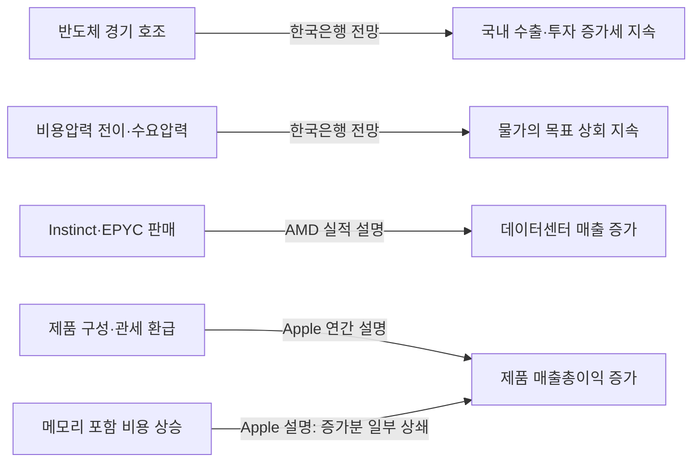

# 2026년 11월 4일 매크로·기업 리서치

정보 기준: **2026-11-04 23:14 KST**, 미국 11월 4일 정규장 개장 전. 한국 주가는 11월 4일 일봉, 미국 주가는 11월 3일 일봉입니다. 작성과 출처 검토는 Codex, 문서의 인과 주장 추출은 로컬 Ollama가 수행했습니다. 사용자 검수는 아직 받지 않았습니다.

## 오늘의 판단

오늘 가장 중요한 변화는 미국 중간선거 이후 의회 구도에 대한 보도입니다. ABC는 AP 개표 데이터를 바탕으로 민주당의 하원·상원 과반 확보를 보도했습니다. 이는 언론의 승자 판정이며 주별 공식 인증 완료와 구분합니다. 새 의원의 임기는 원칙적으로 2027년 1월 3일부터이므로, 오늘의 시장 반응에는 향후 정책에 대한 기대가 반영됩니다. [ABC/AP 결과](https://www.abc.net.au/news/2026-11-04/us-midterm-election-results-2026/107235570), [미 국립문서기록관리청 수정헌법 20조](https://www.archives.gov/founding-docs/amendments-11-27)

**Codex 해석:** 당장 확인할 것은 ‘선거 승리 → 특정 자산 상승’이라는 단선적 결론보다 재정정책 기대, AI 규제 가능성, 기업 실적이 각각 가격에 미치는 방향입니다. AMD의 데이터센터 매출 확대와 Apple의 메모리 비용 부담은 같은 AI·반도체 환경에서도 기업별 영향이 다를 수 있음을 보여줍니다. 아래의 정책 경로는 확인된 법안이나 확정된 가격 예측으로 취급하지 않습니다.

## 1. 중간선거 이후 정책 경로

Reuters는 선거 이후 AI 규제 우려로 선물이 처음 하락했다가 회복한 흐름과 국채금리 하락을 보도했습니다. 기사에 등장한 전문가들은 재정 확대 기대의 약화, AI 정책 불확실성, 중동과 에너지 위험을 서로 다른 요인으로 제시했습니다. 해당 설명은 기사와 인터뷰의 해석이며 독립적으로 식별한 인과효과가 아닙니다. 선물의 장중 변동을 미국 정규장 종가로 표시하지 않습니다. [Reuters 11월 4일 보도](https://www.investing.com/news/economy-news/democrat-sweep-adds-new-twist-to-markets-iran-ai-and-debt-worries-4998678)

| 검토할 경로 | 현재 확인 수준 | 다음 확인 대상 |
| --- | --- | --- |
| 의회 구도 변화 → 재정 확대 기대 변화 → 국채금리·주식 할인율 변화 | 기사 해석에 근거한 시나리오 | 실제 예산안, 국채금리의 만기별 변화 |
| AI 규제 논의 → 투자·수익성 기대 변화 → 기술주 재평가 | 정책 불확실성 시나리오 | 법안·행정부 조치, 기업의 투자 계획 수정 |
| 에너지 공급 위험 → 비용·물가 부담 → 통화정책 제약 | 조건부 분석 경로 | 유가와 물가 지표, 중앙은행 발언 |

위 세 경로는 Codex가 조사 항목으로 구성한 것입니다. 오늘 로컬 모델이 원문에서 추출한 관계와 섞어서 DB에 저장하지 않았습니다.

## 2. 통화정책과 경기의 출발점

| 자료 발표일 | 확인한 수치·서술 | 비교할 때 주의할 점 |
| --- | --- | --- |
| 연준 10월 28일 | 정책금리 목표 범위 3.75~4.00% 유지. 10대 2 표결, 반대 2명은 0.25%p 인상 선호 | 선거 결과만으로 인하를 확정할 근거는 없음 |
| 한국은행 10월 22일 | 기준금리 3.00% 유지. 수출·투자 성장, 물가 압력과 금융안정 위험을 함께 언급 | 오늘 새로 발표된 금리 결정이 아닌 최근 정책 기준점 |
| BEA 10월 29일 | 미국 3분기 실질 GDP +3.4%, 민간 국내 최종판매 +4.9%. 모두 전기 대비 연율 | 전년 동기 대비 증가율과 혼용하지 않음 |
| BEA 10월 29일 | 3분기 PCE 물가 +2.1%, 근원 +2.5%. 모두 전기 대비 연율 | 전년 대비 물가나 연준 목표 달성 여부와 직접 등치하지 않음 |
| BLS 11월 3일 | 9월 구인 건수 750만 건, 구인율 4.5% | 10월 고용보고서가 아니며 노동시장 전체를 단독 판단하지 않음 |

출처: [연준 성명](https://www.federalreserve.gov/newsevents/pressreleases/monetary20261028a.htm), [한국은행 통화정책방향](https://www.bok.or.kr/portal/bbs/P0000559/view.do?menuNo=200690&nttId=11065823), [BEA 3분기 속보치](https://www.bea.gov/news/2026/gdp-advance-estimate-3rd-quarter-2026), [BLS 9월 JOLTS](https://www.bls.gov/news.release/archives/jolts_11032026.htm).

**Codex 해석:** 성장 지표와 분기 물가 둔화가 함께 관측됐지만 연준은 여전히 물가가 높다고 판단했습니다. 오늘의 정치 뉴스와 기존 물가·성장 조건을 함께 살펴야 합니다. 오늘은 예정된 FOMC 결정일이 아니며 다음 정례회의는 12월 8~9일입니다. [연준 회의 일정](https://www.federalreserve.gov/monetarypolicy/fomccalendars.htm)

## 3. Apple만 보지 않고 AI 수요와 비용을 비교

### AMD: 데이터센터 성장과 다른 사업의 차이

11월 3일 발표한 3분기 매출은 **133억 7,700만 달러, 전년 대비 45% 증가**입니다. 데이터센터 매출은 85억 달러로 97% 증가했습니다. 회사는 EPYC 수요와 MI450 출시를 원인으로 설명합니다. 반면 게임 매출은 7억 7,300만 달러로 40% 감소했습니다. 회사 전체 실적을 모든 부문의 동반 성장으로 읽으면 안 됩니다.

4분기 매출 가이던스는 **170억 달러 ±3%**이고 이는 전망입니다. 3분기 GAAP 매출총이익률 54%, non-GAAP 56%를 구분합니다. 해당 수치들은 회사 공시에서 확인했으며 가이던스의 실현을 검증한 것은 아닙니다. [AMD 8-K 첨부 실적자료](https://ir.amd.com/financial-information/sec-filings/content/0000002488-26-000188/q32026991.htm)

### Apple: 매출 증가와 원가 부담을 함께 확인

11월 2일 발표한 회계연도 4분기 매출은 **1,145억 달러, 전년 대비 12% 증가**입니다. 회사 전체 매출총이익률 47.9%에는 관세 환급의 유리한 효과 약 1%p가 포함됐습니다. 이익률 개선을 전부 본업의 구조적 개선으로 해석하지 않습니다. [Apple 공식 실적 발표](https://www.apple.com/newsroom/2026/11/apple-reports-fourth-quarter-results/)

11월 3일 제출한 FY2026 10-K에서는 제품 구성과 관세 환급이 연간 제품 매출총이익을 높였고, 메모리를 포함한 비용 상승이 일부 상쇄했다고 설명합니다. 이는 **연간 제품 부문**에 관한 설명으로, 앞의 **분기 회사 전체** 이익률과 범위가 다릅니다. [Apple 10-K 원문](https://www.sec.gov/Archives/edgar/data/320193/000032019326000026/aapl-20260926.htm)

**Codex 해석:** AI 수요 확대는 AMD의 데이터센터 매출에 유리하게 나타날 수 있지만 부품을 구매하는 기업에는 비용 부담이 될 수 있습니다. 삼성전자·SK하이닉스의 수혜 여부는 별도로 메모리 가격, 판매량, 제품 구성, 투자 부담을 확인해야 합니다. 오늘 두 회사의 실적 공시를 분석한 것은 아니므로 AMD와 Apple 자료만으로 두 회사의 이익이나 주가 상승을 확정하지 않습니다.

## 4. 실제 API로 조회한 가격과 불일치

### 미국: 11월 3일 종가, 메리츠 API

| 종목 | 11월 2일, USD | 11월 3일, USD | 단순 종가 대비 수익률 |
| --- | ---: | ---: | ---: |
| AAPL | 338.32 | 331.90 | -1.90% |
| AMD | 466.84 | 483.90 | +3.65% |
| NVDA | 202.06 | 206.69 | +2.29% |
| SPY | 752.10 | 754.35 | +0.30% |

메리츠 실조회 후 DB에 저장했습니다. 수익률은 `당일 종가 / 전일 종가 - 1`이며 배당을 반영한 총수익률이 아닙니다. **11월 3일 종가를 오늘 확인한 중간선거 결과에 대한 반응으로 해석하지 않습니다.** AMD의 실적 발표 이후 반응도 이 일봉만으로 판단하지 않습니다. 11월 4일 미국 정규장 종가는 아직 수집하지 않았습니다.

### 국내: 11월 4일 종가는 일치하지만 전일 값이 다름

| 종목 | 11월 3일 메리츠, 원 | 11월 3일 한투, 원 | 11월 4일 메리츠·한투, 원 |
| --- | ---: | ---: | ---: |
| 삼성전자 | 222,000 | 219,500 | 221,500 |
| SK하이닉스 | 1,414,000 | 1,398,000 | 1,420,000 |

한투는 원주가 조회 옵션으로 요청했습니다. 전일 값의 차이는 수정주가·거래시장 범위·정정 여부 등 원인을 추가 확인해야 합니다. 삼성전자는 어느 전일 값을 쓰느냐에 따라 등락 방향도 달라져 **국내 당일 수익률과 선거 효과 판단은 보류**합니다. 두 제공자의 원자료를 출처별로 보관했으며 한쪽 값으로 덮어쓰지 않았습니다. KRX 공식 종가와의 최종 대조는 수행하지 않았습니다.

이번 실행에서 메리츠 일봉 14건과 한투 일봉 4건을 저장했습니다. 종목 6개와 국내 대조 2개에 해당하며, 18개 종목을 분석한 것은 아닙니다. 조회만 수행했고 주문은 없었습니다.

## 5. 원문에서 추출한 관계와 품질 점검

다음은 로컬 모델이 추출하고 Codex가 문장 범위를 대조한 주요 관계입니다. 화살표는 문서 작성자가 서술한 영향이며 계량적으로 식별한 인과효과가 아닙니다.

관계별 출처는 위의 한국은행, AMD, Apple 링크입니다. Apple의 마지막 화살표는 이익 증가를 일부 상쇄하는 **부정적 영향**입니다. 다른 회사의 노드를 임의로 연결해 투자 결론을 만들지 않았습니다.

실행 결과는 문서 5건에서 원문 근거가 일치하는 관계 14개였습니다. 근거 문구가 입력에 없는 1개는 저장 전에 자동 제외했습니다. 이후 다음 3개를 Codex가 추가 제외하고 DB 상태를 `rejected`로 바꿨습니다.

| 로컬 관계 ID | 제외 이유 |
| --- | --- |
| 33, 한국은행 | 국채금리 상승과 이후 상승폭 되돌림을 섞고 채권 가격 경로로 치환해 방향이 잘못됨 |
| 35, BEA | 전략비축유 판매가 정부 소비에서 차감되는 회계 처리와 판매 감소라는 조건이 누락됨 |
| 36, BEA | 원인 이름에서 판매 감소, 결과 이름에서 정부 소비라는 범위가 빠짐. 총소비·GDP 효과로 오해할 수 있어 제외 |

BEA는 전략비축유 판매의 해당 회계 처리가 GDP에 직접 영향을 주지 않는다고 명시합니다. 원문 일부가 일치하더라도 문장 밖의 조건과 범위를 확인해야 합니다. 남겨둔 BEA 1개도 소비 항목의 구성 기여 설명이며 구조적 인과관계로 해석하지 않습니다. [BEA 기술 주석](https://www.bea.gov/news/2026/gdp-advance-estimate-3rd-quarter-2026)

나머지 **11개는 `reported_claim`**입니다. 모델의 confidence는 진실 확률이 아니며, horizon과 transmission_channel에는 모델의 해석이 섞일 수 있습니다. 실제 사용자·독립 분석가의 검토나 ECOS·FRED 시계열 교차검증을 완료한 것으로 표시하지 않았습니다. 연준 문서는 인과 주장 0개를 반환했으며 관계를 강제로 만들지 않았습니다.

## 6. 다음 확인 일정과 실행 범위

| 한국 시각 | 확인할 내용 |
| --- | --- |
| 11월 4일 23:30 이후 | 미국 정규장 개장 뒤 반응. 선물과 현물, 가격과 원인 설명을 구분 |
| 11월 5일 22:30 | 미국 3분기 생산성·비용 속보 |
| 11월 6일 22:30 | 미국 10월 고용보고서 |
| 11월 10일 22:30 | 미국 10월 CPI |

BLS 일정은 미국 동부 08:30 발표를 한국 시각으로 변환했습니다. 예정 일정이며 변경 여부를 발표 전에 확인해야 합니다. [BLS 11월 일정](https://www.bls.gov/schedule/2026/11_sched.htm)

이번에는 공개 URL 7개를 Python으로 요청해 5개 문서 발췌를 저장했습니다. BLS와 Reuters는 Python에서 403을 받아 웹 조사 도구로 별도 열람했으며 로컬 LLM 입력에는 포함하지 않았습니다. 기존 브라우저 저장 Apple 10-K를 더해 총 5개 문서를 실제 LLM 분석에 사용했습니다. Apple 10-K 전체를 모두 LLM에 넣은 것은 아니며 문서별 입력은 최대 2,400자 발췌입니다.

Ollama 0.40.14와 `qwen3.5:9b` 약 7.64 GB 모델을 재설치했습니다. 현재 설치본의 강제 JSON 생성 기능이 501을 반환해 스키마를 프롬프트에 제공하고, 결과를 동일한 JSON 스키마·원문 근거 필터로 검증했습니다. 성공한 문서 추출 5회 기준 로컬 입력 4,322토큰, 출력 1,930토큰입니다. 이 수치는 Codex 사용량과 별도이며, 최종 브리핑은 Codex가 취합했습니다. 완전 무인 일일 생성은 아직 구현하지 않았습니다.

재현용 [출처 목록](2026-11-04_sources.json), [실행 요약과 제외 이유](2026-11-04_run_summary.json), 로컬 원문·상세 결과 `data/research_runs/2026-11-04/`를 남겼습니다. 원문·DB·인증 정보는 GitHub에 올리지 않습니다.

설치 과정에서는 Homebrew가 공용 의존성을 갱신하며 Python 3.15를 설치하고 기존 3.14 설치본을 자동 정리했습니다. 프로젝트의 uv 환경에서는 테스트 34개와 코드 검사가 통과했습니다. 모델은 작업 후 메모리에서 내려갔으며 디스크에는 보관돼 있습니다. 확인 시 남은 디스크 공간은 약 15 GiB입니다.

추가 분석: [이차전지·ESS·전력설비 종목 흐름](2026-11-04_sector_brief.md). 대표 종목 11개와 ETF 2개의 가격·기업 실적을 비교했으며 이번 추가분의 테스트는 36개가 통과했습니다.
