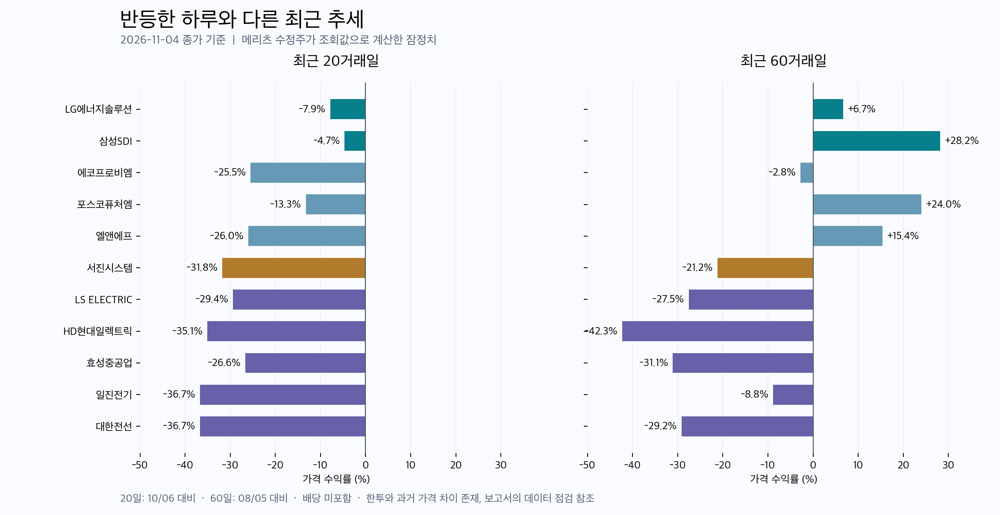

# 이차전지·ESS·전력설비 흐름 — 2026년 11월 4일

기준: 국내 11월 4일 종가. 대표 종목 11개와 비교 ETF 2개의 판단 표본입니다. 업종 전체를 대표하는 지수나 추천 목록은 아닙니다. **가격 표는 메리츠 수정주가 조회값으로 계산한 잠정치**이며 한투와의 과거 가격 차이를 아래에 공개합니다. 실적은 기업 공식 발표, 해석은 Codex가 작성했고 인과 주장 추출에는 로컬 Ollama를 사용했습니다.

## 먼저 볼 흐름

**배터리·ESS는 오늘 강하게 반등했지만 최근 한 달의 조정은 남아 있고, 전력설비는 수주·실적의 성장과 주가 약세가 동시에 나타나고 있습니다.** 사업의 성장과 주가 추세를 각각 확인해야 하는 구간입니다.

- 셀 업체: 삼성SDI는 오늘 +10.6%, 60거래일 +28.2%로 이 표본에서 상대적으로 강합니다. LG에너지솔루션은 오늘 +4.4%지만 최근 5거래일 -4.1%, 20거래일 -7.9%입니다.
- 소재 업체: 포스코퓨처엠과 엘앤에프는 60거래일 수익률이 양수지만 20거래일은 음수입니다. 최근 고점 이후 조정과 오늘의 반등을 나눠 봐야 합니다.
- ESS 시스템: 서진시스템은 오늘 +7.5%여도 20거래일 -31.8%, 60거래일 -21.2%입니다. ESS 성장만으로 모든 관련주의 상승을 설명하기 어렵습니다.
- 전력설비: 표본 5개 모두 20거래일 수익률이 KODEX 200보다 낮습니다. LS ELECTRIC -29.4%, HD현대일렉트릭 -35.1%, 효성중공업 -26.6%입니다. 실적 성장률과 별도로 가격 조정의 지속 여부를 확인할 필요가 있습니다.

위 수치는 아래 동일한 가격 자료로 계산한 관측값입니다. 수익률만으로 공매도, 외국인 매매, 정치 뉴스 등 특정 원인을 식별하지 않았습니다.

## 1. 종목별 주가 흐름

| 구분 | 종목 | 종가, 원 | 오늘 | 5거래일 | 20거래일 | 60거래일 |
| --- | --- | ---: | ---: | ---: | ---: | ---: |
| 셀·ESS | LG에너지솔루션 | 358,000 | +4.4% | -4.1% | -7.9% | +6.7% |
| 셀·ESS | 삼성SDI | 550,000 | +10.6% | +3.2% | -4.7% | +28.2% |
| 소재 | 에코프로비엠 | 97,300 | +9.8% | 0.0% | -25.5% | 약 -2.8% |
| 소재 | 포스코퓨처엠 | 181,300 | +9.3% | +7.9% | -13.3% | +24.0% |
| 소재 | 엘앤에프 | 92,100 | +11.5% | +3.4% | -26.0% | +15.4% |
| ESS 시스템 | 서진시스템 | 29,550 | +7.5% | -10.6% | -31.8% | -21.2% |
| 전력설비 | LS ELECTRIC | 153,600 | +0.2% | -7.7% | -29.4% | -27.5% |
| 전력설비 | HD현대일렉트릭 | 445,500 | -0.2% | -4.5% | -35.1% | -42.3% |
| 전력설비 | 효성중공업 | 2,057,000 | +2.9% | +1.7% | -26.6% | -31.1% |
| 전력설비 | 일진전기 | 55,700 | +2.0% | -7.0% | -36.7% | -8.8% |
| 전력설비 | 대한전선 | 20,150 | +3.1% | -10.2% | -36.7% | -29.2% |
| 비교 ETF | KODEX 200 | 89,715 | +0.4% | -6.1% | 약 -18.9% | 약 -13.9% |
| 비교 ETF | KODEX 코스닥150 | 11,795 | +1.9% | -7.8% | -25.6% | -12.9% |

자료: 메리츠 Open API 국내 일봉, KRX 구분 `J`, 수정주가 옵션 `0`. 수익률은 `100 × (11/4 종가 ÷ 기준일 종가 − 1)`입니다. 기준일은 각각 11/3, 10/28, 10/6, 8/5입니다. 현금 배당을 별도로 재투자한 총수익률이 아닙니다. 20·60거래일은 한 달·세 달과 비슷한 비교 구간이며 정확한 달력 월 수익률과 다릅니다. ETF는 시장 비교용이고 해당 업종 지수는 아닙니다. [메리츠 공식 API 자료](https://github.com/meritz-securities/open-api), [계산 결과·자료 대조](2026-11-04_sector_metrics.json)

**추세 해석:** 이 자료에서 삼성SDI와 포스코퓨처엠은 현재 종가가 20·60일 단순이동평균 위에 있습니다. LG에너지솔루션·에코프로비엠·엘앤에프·서진시스템은 둘 다 아래입니다. 효성중공업은 20일 위, 60일 아래이며 나머지 전력설비 4개는 둘 다 아래입니다. 이동평균 위치는 현재 가격의 상대 위치이며 추세 전환이나 향후 상승을 보장하지 않습니다.

## 2. 이차전지·ESS: 전기차와 ESS를 나눠 볼 이유

### 셀: 실제 출하·가동률 개선이 확인되는 업체

LG에너지솔루션은 11월 3일 3분기 매출 **9조 6,434억 원**, 영업이익 **7,560억 원**을 발표했습니다. 회사는 ESS 출하 증가, EV 물량 증가, 폴란드 가동률과 ESS 신규 공장의 생산성 개선을 설명했습니다. 영업이익에는 북미 생산 보조금 **4,169억 원**이 반영돼 있습니다. 단순 차감액은 3,391억 원이지만 이를 회사가 정의한 별도의 조정 영업이익이나 보조금 소멸 시의 이익 전망으로 취급하지 않습니다. [LG에너지솔루션 공식 실적 발표](https://www.lgensol.com/kr/company/newsroom-detail?seq=8794)

삼성SDI는 10월 29일 3분기 매출 **4조 6,856억 원**, 영업이익 **4,078억 원**을 발표했습니다. 회사는 ESS·BBU 및 원통형 판매 증가를 실적 개선 요인으로 설명했고 올해 확보한 ESS 수주가 60GWh 이상이라고 밝혔습니다. 회사의 4분기 전망은 ESS 성장, 유럽 EV 수요 증가, 미국 EV 수요 둔화를 구분합니다. 따라서 ‘이차전지 전방 수요가 모두 같은 속도로 회복된다’고 읽으면 안 됩니다. [삼성SDI 공식 실적 발표](https://www.samsungsdi.co.kr/sdi-now/sdi-news/5065.html)

**Codex 해석:** 셀 업체의 비교에서는 ESS 매출·수주, 생산 전환과 가동률, 보조금 기여를 함께 봐야 합니다. 오늘 주가 상승분 중 어느 정도가 이 요인에서 나왔는지는 이번 자료만으로 분해하지 않았습니다.

### 소재: ESS 확대가 기존 하이니켈 소재 전체의 동반 수혜는 아님

삼성SDI는 3월 공식 발표에서 엘앤에프로부터 ESS용 LFP 양극재 약 **1.6조 원**을 2027년부터 3년간 공급받는 계약과 추가 3년 옵션을 설명했습니다. 이처럼 소재 업체는 셀 업체의 성장뿐 아니라 **어떤 양극재가 어느 제품에 들어가는지**를 연결해야 합니다. [삼성SDI·엘앤에프 계약 발표](https://www.samsungsdi.co.kr/sdi-now/sdi-news/4821.html?pageIndex=2&pagesize=15)

포스코퓨처엠도 8월 발표에서 LFP 장기 공급 합의와 기존 하이니켈 라인의 일부 전환을 설명했습니다. 당시 발표에는 정식 계약의 후속 체결 예정과 연말 양산 목표가 포함돼 있습니다. 이 8월 자료만으로 11월 현재 최종 계약·인증·양산 완료를 확정하지 않았습니다. [포스코퓨처엠 공식 발표](https://www.poscofuturem.com/pr/view.do?num=1039)

**Codex 해석:** 에코프로비엠·포스코퓨처엠·엘앤에프를 같은 테마로 묶어 매수 판단을 내리기보다 LFP와 하이니켈의 고객 구성, 실제 출하 개시, 재고 손익과 현금흐름을 따로 확인해야 합니다. 이번에는 세 회사의 최신 분기 공시 전체를 검토하지 않았으므로 실적 우열 순위를 매기지 않았습니다.

### 시스템: 산업 성장과 개별 종목의 가격은 별개

서진시스템은 공식 사업 소개에서 ESS 장비 제조 역량을 설명합니다. 셀 업체와 사업 단계가 다르므로 제조·조립 매출과 수익성, 고객 주문의 인식 시점 등을 별도로 봐야 합니다. 오늘의 반등에도 불구하고 관측한 20·60거래일 가격은 약합니다. 최신 분기의 고객별 매출·이익을 확인하지 않은 상태에서 약세 원인을 특정 고객의 주문 감소로 단정하지 않습니다. [서진시스템 사업 소개](https://seojinsystem.net/business/sector.php)

## 3. 전력설비: 수주잔고 확대와 분기 실적의 차이

| 회사 | 공식 발표에서 확인한 내용 | 다음 확인 항목 |
| --- | --- | --- |
| LS ELECTRIC | 3분기 매출 1조 8,778억 원, 영업이익 2,335억 원. 전년 대비 각각 +54.4%, +131.7%. AI 데이터센터·초고압 프로젝트가 성장 요인이라는 회사 설명. 수주잔고 약 7조 원 | 수주가 실제 매출·현금으로 전환되는 속도, 고부가 제품 구성 |
| HD현대일렉트릭 | 3분기 매출 1조 1,799억 원, 영업이익 2,845억 원. 영업이익률 24.1%로 전분기 25.1%보다 하락. 신규 수주 9.8억 달러로 전분기 -31.9%, 전년 -19.1%. 수주잔고는 88.43억 달러로 전년 +26.6% | 신규 수주의 회복, 수주잔고의 납품 일정, 지역·제품 구성에 따른 마진 |
| 효성중공업 | 연결 영업이익 2,435억 원으로 전분기 2,643억 원보다 감소. 중공업부문 수주잔고는 18.9조 원으로 전년 +71%. 회사는 물류에 따른 매출 이연과 일부 건설 현장 원가 상승을 설명 | 이연 매출의 실제 인식, 중공업과 건설의 손익 분리 |
| 대한전선 | 3분기 매출 1조 1,764억 원, 영업이익 309억 원. 각각 전년 +37.6%, +4.5%. 9개월 누적 영업이익 1,521억 원, 분기 말 수주잔고 약 4.3조 원 | 매출 성장에 비해 이익 증가가 작은 이유와 프로젝트별 수익성 |

출처: [LS그룹 공식 보도자료](https://lsholdings.com/ko/media/news/4b72586b48496a526c6d5244452b77446f62746d344f59655a6952323172613133794a69373836766342413d), [HD현대일렉트릭 10/27 IR 자료, PDF 4~6쪽](https://www.hd-hyundaielectric.com/elect/ko/IR/IRdata1.jsp), [효성중공업 10/30 IR 자료, PDF 3·6·9쪽](https://www.hyosungheavyindustries.com/kr/company/ir/archive/annual-report), [대한전선 10/29 공식 발표](https://www.taihan.com/en/news/pr/taihanNewsDetail?idx=764). 모두 발표 당시 자료이며 잠정 실적은 향후 바뀔 수 있습니다. 일진전기는 가격 비교에는 포함했지만 이번에 최신 분기 실적을 직접 검토한 회사에는 포함하지 않았습니다.

**Codex 해석:** 전력설비 표본의 최근 주가 약세와 공식 수주잔고 확대는 동시에 성립합니다. ‘업황이 좋으니 주가가 바로 오른다’거나 ‘주가가 하락했으니 수요가 붕괴했다’고 단정할 근거는 부족합니다. 기대 성장률·평가 배수의 변화, 납품 지연, 사업 구성 등을 확인할 필요가 있지만 이 중 무엇이 주가를 얼마나 움직였는지 검증하지 않았습니다.

## 4. 다음 관찰 순서

| 분야 | 실제 사업에서 확인할 것 | 가격에서 확인할 것 |
| --- | --- | --- |
| 셀·ESS | ESS 출하와 가동률, 보조금 포함·제외 손익의 구분 | 오늘 반등 이후 5·20거래일 수익률이 개선되는지 |
| 양극재 | LFP 고객 인증과 출하, 하이니켈 수요, 재고·현금흐름 | 셀 업체 대비 상대 약세가 줄어드는지 |
| ESS 시스템 | 수주 발표와 매출 인식, 고객별 이익 기여 | 반등 뒤에도 최근 저점과 이동평균을 회복하는지 |
| 변압기·배전 | 신규 수주·기존 수주잔고·납품을 나눠 추적 | KODEX 200 대비 부진이 줄어드는지 |
| 전선 | 수주 매출화와 프로젝트 이익률 | 거래량을 동반한 가격 회복이 이어지는지 |

이 순서는 모니터링 항목이며 매수·매도 신호를 산출한 결과가 아닙니다. 원자재·환율·외국인 수급 시계열까지 이번에 교차검증한 것은 아닙니다.

## 5. 데이터 점검과 실행 기록

- **가격 수집:** 7/15~11/4, 종목·ETF별 75개 일봉. 메리츠 975건, 한투 원주가 975건, 한투 수정주가 975건을 출처별 DB에 보관했습니다. 한투 원주가와 수정주가를 섞어서 수익률을 계산하지 않았습니다.
- **대조 결과:** 최신 종가는 13개 모두 메리츠·한투에서 일치했습니다. 네이버 차트와 메리츠 종가를 비교하면 11개는 75일 전체 일치, 에코프로비엠은 과거 34일, KODEX 200은 70일에서 차이가 있었습니다. 두 종목의 차이는 가격 조정 처리와 관련될 수 있으나 확정하지 않았습니다. 네이버와 증권사 자료는 같은 상위 공급원을 공유할 수 있습니다.
- **미해결 차이:** 한투 수정주가도 메리츠와 과거 가격이 다릅니다. 수정 여부를 맞추는 것만으로 해결되지 않았습니다. 예를 들어 HD현대일렉트릭의 오늘 등락은 메리츠 -0.2%, 한투 +1.5%로 방향도 다릅니다. 따라서 표는 메리츠 기준으로 명시한 잠정치이며 KRX의 최종 검증값으로 제시하지 않습니다.
- **재현 자료:** [대상 종목·선정 범위](2026-11-04_sector_universe.json), [출처 목록](2026-11-04_sector_sources.json), [가격 지표와 대조 건수](2026-11-04_sector_metrics.json). 증권사 원문은 `data/research_runs/2026-11-04/sectors/`, 문서 추출 결과는 `data/research_runs/2026-11-04-sectors/`에 보관했습니다.
- **문서 수집:** 공개 HTML 5건 중 4건을 수집했습니다. 포스코퓨처엠 페이지는 Python 연결에 실패해 웹 조사 도구로 별도 읽었습니다. HD현대일렉트릭·효성중공업 PDF는 공식 사이트에서 별도 내려받아 텍스트를 확인했습니다.
- **LLM 역할:** LG에너지솔루션·삼성SDI·LS ELECTRIC·대한전선 문서 발췌를 로컬 `qwen3.5:9b`로 분석했습니다. 최초 4회와 일부 재요청 2회를 수행했습니다. 삼성SDI는 저장된 응답의 JSON 코드 블록 표기를 제거한 뒤 동일한 스키마·근거 검사를 통과했으며 추가 호출은 없었습니다. 자료형·근거 검사를 통과해 저장한 8개 중 근거 범위를 넓힌 1개를 Codex가 제외했고 **7개를 `reported_claim`으로 보관**했습니다. 대한전선 발췌에서는 관계 0개를 반환했으며 강제 생성하지 않았습니다.
- **검토 한계:** 기업 설명은 독립적으로 입증한 인과관계가 아닙니다. confidence는 진실 확률이 아니고 horizon·전달 경로는 모델 해석을 포함할 수 있습니다. 최종 비교·해석은 Codex 작성이며 사용자·독립 분석가의 검수는 아직 없습니다.

문서별 최대 2,400자, 재요청은 최대 1,400자를 사용했습니다. 가격 수익률은 Python이 계산했고 LLM이 계산하지 않았습니다. 모델 응답 전체를 감싼 단일 JSON 코드 블록만 허용하도록 읽기 처리를 보완했으며 설명문 혼입·잘못된 자료형·원문 근거 불일치의 검사는 유지했습니다. 테스트 36개가 통과했습니다.
